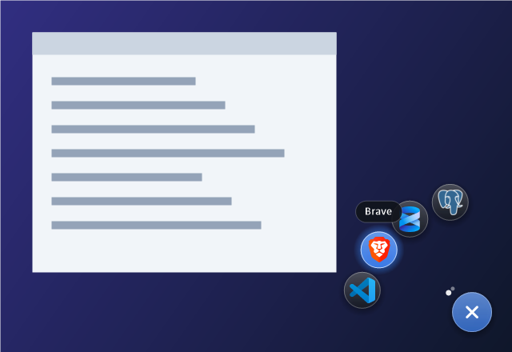
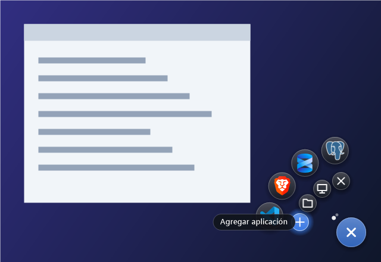

<p align="center">
  
</p>

<h1 align="center">Lanzador radial</h1>

<p align="center">
  Un botón flotante para Windows que abre tus aplicaciones en un arco,<br>
  <b>sin minimizar ni salir de la ventana en la que estás trabajando</b>.
</p>

<p align="center">
  <a href="https://github.com/VMendoza2603/lanzador-radial/releases/latest/download/LanzadorRadial.exe">
    
  </a>
</p>

<p align="center">
  <a href="https://github.com/VMendoza2603/lanzador-radial/releases/latest"></a>
  
  
  <a href="LICENSE"></a>
</p>

<p align="center">
  
</p>

## ¿Qué es y para qué sirve?

El Lanzador radial pone un pequeño botón redondo en la esquina inferior derecha de la pantalla. Al hacer clic, tus programas aparecen en un arco alrededor del botón y los abres con un clic más.

Sirve para tener a mano los programas que usas para trabajar o estudiar (editor de código, navegador, bases de datos, Word…) sin ir al escritorio, buscar en el menú Inicio ni minimizar lo que estás haciendo. Mientras lo usas, la ventana en la que escribes **sigue activa**: el lanzador nunca le quita el foco.

Se abre solo cuando tú quieres (no arranca con Windows) y se esconde solo cuando un juego o un video está a pantalla completa.

## Consumo y requisitos

Medido en Windows 11 con un AMD Ryzen 7 5700G y 8 aplicaciones cargadas:

| | Lanzador radial |
|---|---|
| **Tamaño del programa** | 52 KB (un solo `.exe`) |
| **Memoria RAM** | ~42 MB en uso (~25 MB propios; el resto son librerías de Windows compartidas) |
| **CPU en reposo** | 0 % (medido durante 1 minuto) |
| **CPU al abrir o cerrar el arco** | Un instante de ~0,2 s mientras dura la animación; luego vuelve a 0 % |
| **Tarjeta gráfica** | No la usa; no afecta a los FPS de tus juegos |
| **Arranque** | ~0,4 s hasta que aparece el botón |
| **Disco** | Solo guarda los accesos directos que agregas (unos KB cada uno) |
| **Internet** | No se conecta a nada |
| **Inicio con Windows** | No; solo funciona cuando tú lo abres |
| **Instalación** | No necesita; es portable |
| **Permisos de administrador** | No |

| Requisito | |
|---|---|
| **Sistema** | Windows 10 u 11 (64 o 32 bits) |
| **.NET Framework 4** | Ya viene incluido en Windows 10 y 11; no hay que instalar nada |
| **Pantalla** | Cualquier resolución; se adapta a la escala de Windows (100 %, 125 %, 150 %…) |

## Descargar y abrir

1. Pulsa el botón **Descargar** de arriba (o ve a **[Releases](../../releases/latest)**) para bajar **`LanzadorRadial.exe`**.
2. Ponlo en la carpeta que quieras, por ejemplo `Documentos\LanzadorRadial` (o en una USB).
3. Haz **doble clic**: aparece el botón abajo a la derecha.
4. **Clic derecho** en el botón → **+** para agregar tus aplicaciones.

Para cerrarlo, vuelve a hacer doble clic en el `.exe` o usa **clic derecho → ×**.

> **Si Windows muestra "Windows protegió su PC"** (SmartScreen), pulsa **Más información → Ejecutar de todas formas**. Aparece con cualquier programa descargado de internet que no esté firmado. Todo el código está en la carpeta `src` de este repositorio.

## Controles

### Botón flotante

| Acción | Qué hace |
|---|---|
| **Clic izquierdo** | Abre el arco de aplicaciones. Otro clic izquierdo lo cierra. |
| **Clic derecho** | Abre las opciones (iconos pequeños). Otro clic derecho las cierra. |
| **Rueda del ratón** | Abre el arco, o pasa a las siguientes 4 apps si ya está abierto. |
| **Arrastrar y soltar** un programa o acceso directo | Lo agrega al lanzador. |

### Arco de aplicaciones

| Acción | Qué hace |
|---|---|
| **Pasar el ratón** sobre una app | La agranda y muestra su nombre. |
| **Clic** en una app | La abre y cierra el arco. |
| **Rueda del ratón** | Pasa a las siguientes 4 apps. Los puntitos junto al botón indican la página. |
| **Clic** en cualquier otra parte de la pantalla | Cierra el arco. |

### Opciones (clic derecho)



| Icono | Qué hace |
|---|---|
| **+** | Agregar aplicaciones: programas (`.exe`) o accesos directos. |
| **Carpeta** | Abre la carpeta `apps`, donde están tus accesos directos. |
| **Pantalla** | Crea un icono del lanzador en el escritorio, o lo quita si ya existe. |
| **×** | Cierra el lanzador. |

### Icono del `.exe` o del escritorio

| Acción | Qué hace |
|---|---|
| **Doble clic** con el lanzador cerrado | Lo abre. |
| **Doble clic** con el lanzador abierto | Lo cierra. |

## Elegir tus aplicaciones

Las apps son **accesos directos** guardados en la carpeta `apps`, que se crea junto al `.exe`. Puedes agregarlas de tres formas:

- Clic derecho en el botón → **+**. El diálogo abre en la carpeta del menú Inicio, donde están casi todos los programas instalados.
- Arrastrar un programa, acceso directo o carpeta sobre el botón.
- Copiar accesos directos a mano en la carpeta `apps`.

**Orden:** se ordenan por nombre de archivo. El lanzador numera las que agregas (`01 Visual Studio Code.lnk`, `02 Brave.lnk`…); cambia los números para reordenarlas. El número no se muestra en el nombre.

**Quitar una app:** borra su acceso directo de la carpeta `apps`. El lanzador se actualiza solo.

> Si pones el `.exe` en una carpeta donde no se puede escribir (como `Archivos de programa`), las apps se guardan en `%APPDATA%\LanzadorRadial\apps`.

## Desinstalar

Ciérralo (clic derecho → **×**) y borra el `.exe` y su carpeta `apps`. Si creaste el icono del escritorio, quítalo antes desde las opciones o bórralo a mano. No deja nada más en el sistema: no toca el registro ni instala servicios.

## Preguntas frecuentes

**¿Afecta al rendimiento de mis juegos?**
No. En reposo usa 0 % de CPU, no usa la tarjeta gráfica y se esconde solo cuando un juego está a pantalla completa.

**¿Arranca solo con Windows?**
No. Lo abres cuando lo necesitas y lo cierras cuando terminas.

**¿Por qué no aparece el botón?**
Si tienes un juego o un video a pantalla completa, se esconde a propósito y vuelve al salir. Si no, puede que ya estuviera abierto y el doble clic lo haya cerrado: haz doble clic otra vez.

**¿Mi antivirus lo bloquea?**
Algunos antivirus desconfían de los programas nuevos sin firma. Puedes revisar el código o compilarlo tú mismo (ver abajo).

**¿Se ve borroso o pequeño?**
Se adapta a la escala de Windows al abrirse. Si cambias la escala, ciérralo y vuelve a abrirlo.

## Compilar desde el código

No hace falta instalar Visual Studio: Windows ya trae el compilador de C#.

1. Clona o descarga este repositorio.
2. Haz doble clic en **`compilar.cmd`**.
3. El programa queda en `dist\LanzadorRadial.exe`.

```
lanzador-radial/
├── compilar.cmd           ← genera el .exe
├── src/
│   ├── LanzadorRadial.cs  ← todo el código (C#, Windows Forms)
│   └── lanzador.ico       ← el icono
└── docs/                  ← imágenes de este README
```

**Cómo funciona por dentro:** el botón y el arco son ventanas transparentes por píxel (*layered windows*) que no toman el foco. Así el lanzador flota sobre todo sin interrumpir lo que estás escribiendo. Los iconos se leen de cada acceso directo, sin la flechita.

## Licencia

[MIT](LICENSE): puedes usarlo, modificarlo y compartirlo libremente.
